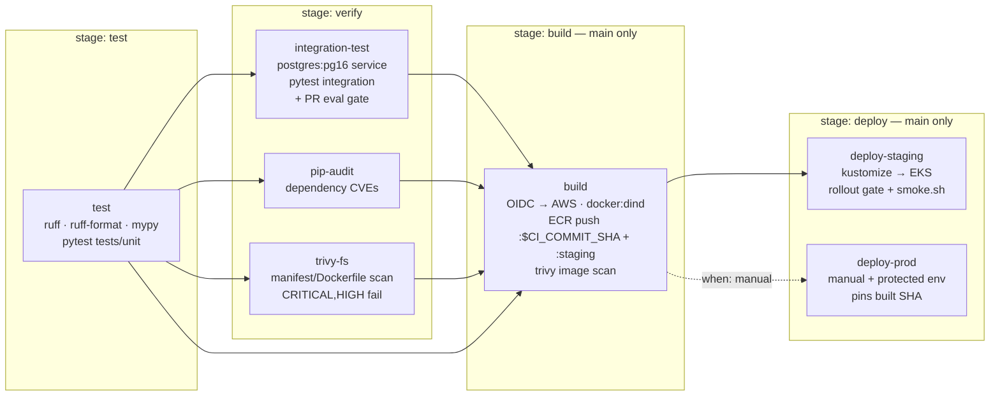

# CI/CD — GitLab pipeline

Pipeline definition: `.gitlab-ci.yml` (migrated from GitHub Actions).
Runs on every branch push and merge request; build + deploy jobs are
restricted to the default branch (`main`). Prod deploys are manual.

Author: venkateshwara doijode

---

## Pipeline diagram



## Flow

| stage | job | gate semantics |
|---|---|---|
| `test` | `test` | lint (ruff check + format), typecheck (mypy), unit tests — all must pass before anything else runs |
| `verify` | `integration-test` | Postgres/pgvector service container; integration tests (self-skip on missing deps) + `eval/runner.py --suite pr --fail-on-leak --fail-on-thresholds` — **zero-tolerance ACL leak gate** |
| `verify` | `pip-audit` | known-CVE scan of the installed env (`--skip-editable`) |
| `verify` | `trivy-fs` | filesystem scan of Dockerfiles, k8s manifests, secrets — CRITICAL/HIGH fail the job |
| `build` | `build` | GitLab OIDC → `sts:AssumeRoleWithWebIdentity` → ECR login; builds + pushes `agentic-rag-backend` / `agentic-rag-frontend` tagged `$CI_COMMIT_SHA` and `staging`; trivy image scan on both; exports `ECR_REGISTRY` via a **dotenv artifact** |
| `deploy` | `deploy-staging` | `kustomize edit set image` → `kubectl apply` on the staging overlay → `rollout status` (180s/120s) → `deploy/scripts/smoke.sh staging` |
| `deploy` | `deploy-prod` | same flow against `overlays/prod` with longer timeouts; **manual trigger** (`when: manual`) on `main` + GitLab **protected `production` environment** = the approval gate; pins the exact built SHA, never a floating tag |

`needs:` forms the DAG — every red gate stops the pipeline before build
and deploy. `interruptible: true` lets a newer pipeline cancel stale test
jobs on the same ref; deploy jobs are `interruptible: false` and
serialized per env via `resource_group` (the `cancel-in-progress: false`
equivalent). No `|| true` anywhere — a failed apply, rollout, or smoke
check fails the job.

## GitHub Actions → GitLab mapping

| GitHub Actions | GitLab CI |
|---|---|
| `on: push/pull_request/workflow_dispatch` | `workflow: rules` on branch pushes + `merge_request_event` |
| `needs:` job graph | `needs:` job graph (same DAG) |
| `concurrency` / `cancel-in-progress` | `interruptible: true|false` + `resource_group` for deploy serialization |
| `permissions: id-token` + `configure-aws-credentials` | `id_tokens:` + `aws sts assume-role-with-web-identity` |
| `services:` postgres container | `services:` + `alias: postgres` (host `postgres`) |
| `github.sha` | `CI_COMMIT_SHA` |
| `needs.build.outputs.registry` | `artifacts: reports: dotenv: build.env` → `$ECR_REGISTRY` |
| `environment:` + required reviewers | `environment:` + **protected environments** (Settings → CI/CD) |
| `workflow_dispatch` for prod | `when: manual` job on the default branch |
| Actions pinned to commit SHA | images/tools pinned by tag (`docker:27.3.1`, `alpine/k8s:1.31.2`, `aquasec/trivy:0.58.0`, `TRIVY_VERSION`) |

## Required CI/CD variables

Configure masked/protected in **Settings → CI/CD → Variables**:

| Variable | Purpose |
|---|---|
| `AWS_ROLE_ARN` | IAM role assumed via GitLab OIDC (`id_tokens`, audience `sts.amazonaws.com`) |
| `EKS_CLUSTER` | cluster name for `aws eks update-kubeconfig` |
| `SMOKE_API_KEY` / `SMOKE_USER_ID` | optional — enables the authenticated answer probe in `smoke.sh` |

AWS side: an IAM OIDC provider for the GitLab instance
(`gitlab.com` or self-managed host) with `aud = sts.amazonaws.com`, and a
role trust policy scoped to this project's default branch — same shape
the old `AWS_ROLE_ARN` repo secret used, only the token source changes.

Protected environments: mark `production` (and optionally `staging`)
protected under **Settings → CI/CD → Protected environments** and require
approvers — that is the prod approval gate, replacing GitHub
environment reviewers.

## Dry run / local validation

```bash
# syntax + structure (no GitLab instance needed)
python -c "import yaml,sys; yaml.safe_load(open('.gitlab-ci.yml'))"

# run the actual gate commands locally
make lint            # ruff + format + mypy  → the `test` job
make test-unit       # pytest tests/unit -q   → the `test` job
make test-integration  # needs local Postgres/OpenSearch → `integration-test`
python eval/runner.py --suite pr --fail-on-leak --fail-on-thresholds

# full pipeline lint/simulation (optional, needs node + docker)
npx gitlab-ci-local --preview        # render the resolved pipeline
npx gitlab-ci-local                  # execute jobs locally in containers
```

Server-side lint is also available via GitLab's **CI Lint** page
(Build → Pipeline editor → Lint) or
`POST /api/v4/projects/:id/ci/lint` once the project lives on GitLab.

## Rollback

```bash
kubectl rollout undo deployment/backend   -n agentic-rag   # or --to-revision=N
kubectl rollout undo deployment/streamlit -n agentic-rag
```

Or redeploy a known-good SHA: play the manual `deploy-prod` job on the
pipeline for that commit, or
`kustomize edit set image ... :<known-good-sha>` + `kubectl apply`.
Details: `deploy/README.md`, `docs/PROD_RUNBOOK.md` §5.
