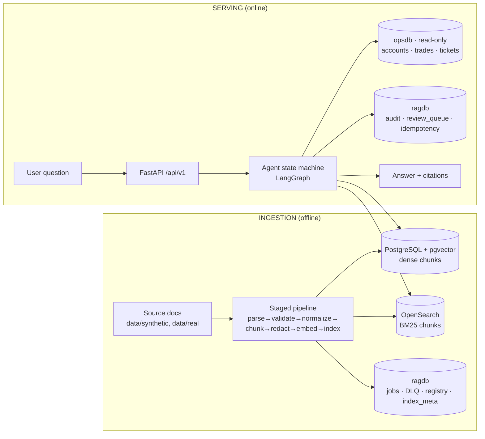
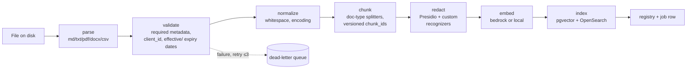
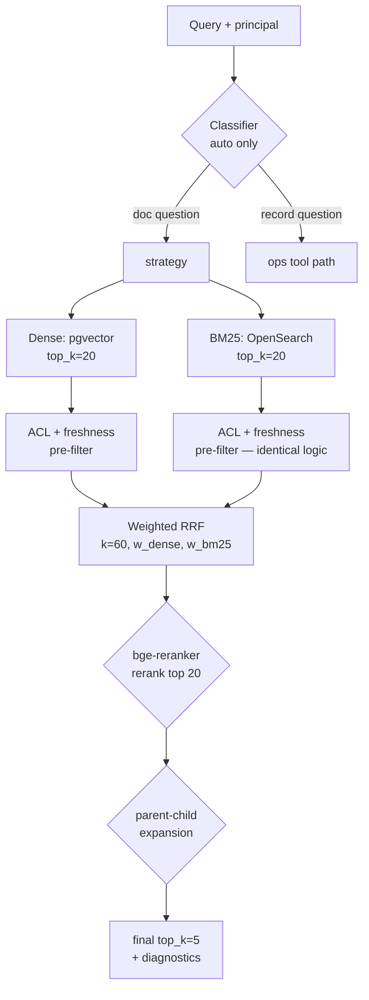
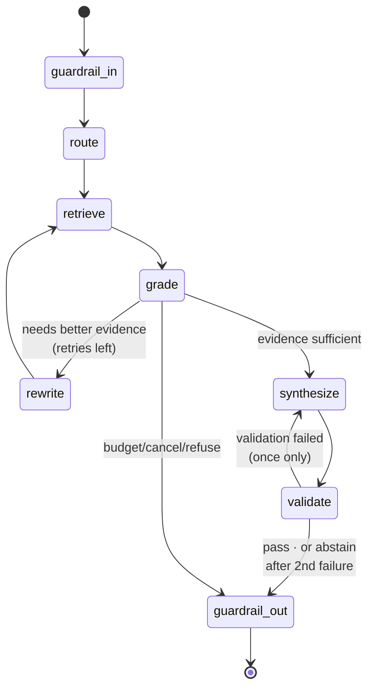
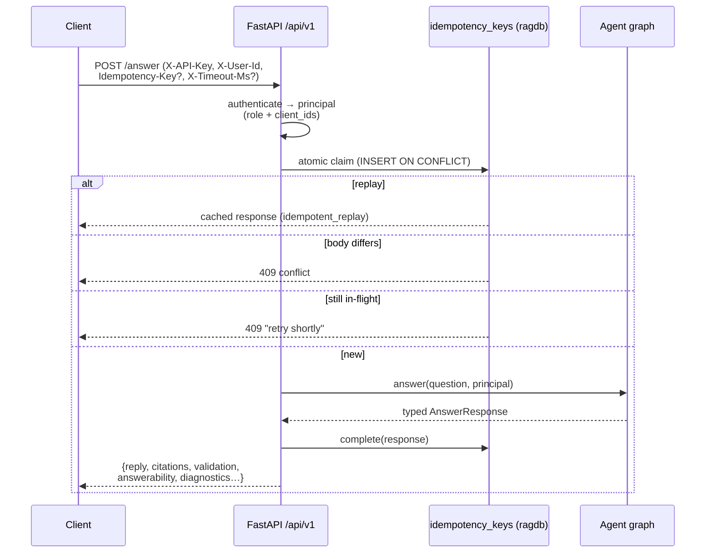

# Agentic RAG — End-to-End Workflow

How a document becomes searchable knowledge, and how a user question
becomes a governed, cited answer. Mermaid diagrams render on GitHub;
every section also links the implementing code.

Author: venkateshwara doijode

---

## 1. The big picture

Two pipelines share the same stores:



- **Left**: documents flow through a staged ingestion pipeline into two
  indexes — a vector index for semantic search and a lexical index for
  keyword search — plus bookkeeping tables (job tracking, dead letters,
  document registry, index metadata).
- **Right**: a question enters the API, runs through an explicit agent
  state machine that retrieves, grades, drafts, and *independently
  validates* an answer, and returns the answer with versioned citations —
  while every step is audited.

---

## 2. Ingestion pipeline — how documents get in



`src/app/data/ingest/pipeline.py::ingest_document` — composes the stages,
**never raises**; each document yields an `IngestResult` (indexed /
skipped / failed with sanitized error).

Key behaviors:

| Behavior | What it means | Code |
|---|---|---|
| **Incremental** | file-hash diff vs `document_registry`; unchanged docs skipped, changed docs delete-then-reindex | `pipeline.py` |
| **Versioning** | `doc_version_policy`: `latest` (old chunks deleted) or `keep_all` (versions coexist); `chunk_id` embeds version — `AGR-002:v2.0:2-fee-schedule:2` | `chunking.py` |
| **Dedup** | content-hash dedupe inside a doc | `indexing.py` |
| **Dead letters** | per-doc retry ≤ `ingest_max_attempts`, then a DLQ row with sanitized reason; retry via CLI/admin | `jobs.py`, `cli.py`, `admin.py` |
| **Delete propagation** | deleting a doc removes its chunks from *both* stores | `vectorstore.py`, `lexical.py` |
| **Consistency** | three-way check: registry ↔ pgvector ↔ OpenSearch | `indexing.py::verify_consistency`, `copilot docs verify` |
| **Metadata preserved** | doc_id, version, section, page, chunk_id, client_id, roles, effective/ expiry dates, doc_type, content hash | `chunking.py` |

Ops data (accounts/trades/tickets) is seeded separately into `opsdb` —
documents and records live in different stores on purpose: **documents
are searchable; records are queryable only through read-only tools.**

---

## 3. Retrieval — how evidence is found



`src/app/agent/nodes/retrieve.py` + `src/app/retrieval/`.

| Feature | Detail |
|---|---|
| **Strategies** | `dense` · `bm25` · `hybrid` · `hybrid_rerank` · `auto` (classifier picks) — env `RETRIEVAL_STRATEGY` |
| **Fusion** | weighted reciprocal rank fusion; `rrf_k`, `rrf_dense_weight`, `rrf_bm25_weight` tunable and recorded in diagnostics |
| **ACL parity** | the *same* `ACLFilter` produces the Postgres `WHERE` clause and the OpenSearch filter — non-negotiable; unauthorized docs are filtered in the query, never post-filtered |
| **Freshness** | `doc_expiry_mode=exclude` (expired docs never returned) or `down_rank` (returned but penalized + flagged `stale`) |
| **Parent-child** | small chunks match → parent section text returned for context (`parent_child_enabled`) |
| **Diagnostics** | per-collection: `dense_ids`, `bm25_ids`, `fused_ids`, `reranked_ids`, counts, skipped stores, classifier verdict — this is what powers the per-stage recall metrics |

Store outages are captured into `errors` (e.g. `store_unavailable:opensearch`)
and the graph degrades gracefully instead of crashing.

---

## 4. The agent — an explicit state machine



`src/app/agent/graph.py` + `src/app/agent/nodes/`. Every node takes state,
returns a partial-state dict — independently unit-testable, no cross-node
calls.

### What each node does

| Node | Job | Key outputs |
|---|---|---|
| `guardrail_in` | entitlement scope, injection screening, seed budget | `principal`, refusal on out-of-scope client hints |
| `route` | classify question → doc retrieval and/or ops tools; extract filters (`open tickets`, `failed trades`); honor `client_id` hint if entitled | `collections`, `tools`, `extra.ops_filters` |
| `retrieve` | run the retrieval pipeline and/or read-only ops tools (single snapshot for multi-store reads) | `retrieved`, `tool_results`, `diagnostics`, `errors` |
| `grade` | is the evidence good enough? relevance check (rerank score when present, else fused score); sets `failure_type` + `answerability` | `missing_evidence` / `low_relevance` / `conflicting_documents` / `incomplete_facts` |
| `rewrite` | failure-type-driven query rewrite (bounded by `agent_max_retries`) | new query terms |
| `synthesize` | draft answer from *redacted copies* of evidence; offline heuristic fallback when no LLM | `reply`, `citations` |
| `validate` | **independent checker**: every claim must be cited and supported by its cited passage; numbers checked inside the cited passage; tool-cited claims checked against ops rows; chunk_id-resolving citations | `validation{claims, unsupported_claims, invalid_citations, contradictions, verdict}` |
| `guardrail_out` | final PII rescan, refusal/abstain propagation, **budget breach → refusal**, audit terminal event, review-queue enqueue | final response state |

### Answerability — the five honest verdicts

`fully_answerable` · `partially_answerable` (caveats attached) ·
`insufficient_evidence` (abstain — "I don't have enough to answer
reliably") · `conflicting_evidence` (surface the disagreement, don't pick
sides) · `unauthorized` (refusal — indistinguishable from "doesn't exist").

### Budgets — why it can't loop forever

Every conditional edge checks `budget.refusal_update` **and** `cancelled`
first:

| Budget | Type | Limit |
|---|---|---|
| iterations (retrieve passes) | hard | 6 |
| tool calls | hard | 10 |
| elapsed ms | hard | 60 000 (tightenable via `X-Timeout-Ms`) |
| tokens | soft — recorded, best-effort continues | 20 000 |
| cost USD | soft | $0.25 |
| retries (grade↔rewrite) | hard | 2 |

Hard breach ⇒ refusal state written and routed to `guardrail_out`.
Refusal/abstain paths never carry drafted content.

### Human review

Partial/conflicting/low-support/high-impact/ops-error answers enqueue to
`review_queue` (`pending_review: true`); reviewers resolve via
`POST /api/v1/admin/review/{id}/decision`. A queue *failure* reports
honestly — it never claims a review is pending when the insert failed.

---

## 5. API layer — how callers reach the agent

`src/app/main.py`, `src/app/api/routers/`.



| Concern | Implementation |
|---|---|
| **Versioning** | `/api/v1/*` (legacy flat routes kept, deprecated) |
| **Errors** | uniform envelope `{"error": {code, message, request_id}}` — no raw exception text leaks |
| **Idempotency** | Postgres-backed atomic claim shared across the 2–8 replicas; honors `idempotency_ttl_s`; local dict fallback only when ragdb is down (logged as degraded) |
| **Streaming** | `POST /answer/stream` — SSE node-by-node deltas; **each delta is PII-sanitized before send**; disconnect checked between events → cooperative cancel into the graph |
| **Timeout** | `X-Timeout-Ms` tightens (never widens) the elapsed budget |
| **Health tiers** | `/health` (process), `/ready` (503 if any dep down), `/deps` (per-store latencies) |

---

## 6. Security & compliance controls

| Control | Where | Guarantee |
|---|---|---|
| Authentication | `security/authn.py` — API key + user → `Principal{role, client_ids}` | prototype: JSON fixture; OIDC is the production target |
| Authorization | ACL pre-filter in **both** stores; ops tools gate `assert_ops_allowed` + `assert_entitled_rows` | unauthorized rows indistinguishable from missing |
| Read-only ops | `tools/ops/` — SELECT-only assertion, READ ONLY session, statement timeout, row caps, `rag_readonly` SQL role | no write path exists |
| PII | redacted at ingest → prompt copies → audit payloads → **SSE deltas** → final-output rescan; Presidio + custom business-ID recognizers; `redaction_eval.py` measures precision/recall | no raw PII reaches users, logs, or streams |
| Audit | `observability/audit.py` — one `audit_events` row per node/decision, PII-redacted, JSON-safe | replayable request trail |
| Review queue | risky answers flagged for human decision | non-blocking, honest failures |
| Idempotent writes | `idempotency_keys` table | duplicate submissions never double-execute |

---

## 7. Evaluation — how we know it works

`eval/` + `docs/RAGAS.md` for the judge-specific guide.

- **Suites**: `pr` (CI gate) · `dev` · `holdout` (release gate, never tuned
  to) · `golden` (generated).
- **Deterministic metrics** (always run, free): citation precision/recall/
  correctness/completeness, per-stage retrieval recall (dense/BM25/fused/
  reranked), refusal & answerability correctness, tool selection,
  unsupported-claim rate, **`acl_clean` — zero tolerance**,
  `must_not_contain`.
- **Ragas** (LLM judge, needs `ANTHROPIC_API_KEY`): faithfulness,
  answer_relevancy, context_precision/recall, answer_correctness —
  configured via `eval/ragas.yaml` (metrics, judge model, run limits,
  quality thresholds).
- **Release gates**: `--fail-on-leak` (ACL), `--fail-on-thresholds` (Ragas
  floors) — both exit non-zero.
- **Reports**: `eval/reports/eval_<ts>.{json,md}` with `version_snapshot`
  (model, embedder, prompt hashes, dataset hash, git SHA) so any two runs
  are comparable; `--repeat N` adds variance ± 95% CI.
- **Baseline comparison**: `src/app/baseline.py` is the plain-RAG control —
  same stores/model but no routing, tools, grading, validation, guardrails,
  or ACL (unless `*-acl` variant). `--system all` runs every variant and
  `eval/compare.py` writes `compare_<ts>.md` — the side-by-side table that
  shows what the agent loop actually earns (the gap lives in conflicting/
  ambiguous/unanswerable/adversarial rows, not easy factual ones).

## 8. Deployment shape

`deploy/k8s/` — HPA 2–8 replicas + PDB; prod secrets via `ExternalSecret`
(AWS SM); CI (`ci.yml`) runs lint/tests/PR-eval gate → build+scan → deploy
with rollout checks + `deploy/scripts/smoke.sh`.

Why design choices matter at scale: shared Postgres idempotency (2–8
pods), stateless graph nodes, graceful store-degradation, self-DDL tables
for ragdb-side state.

## 9. End-to-end example — one real request

```
Q: "Show open tickets for bluepeak"   (user u_agent1, entitled: bluepeak…)
```

1. `guardrail_in` — principal resolved, scope = {bluepeak, acme, crestline, dawnmere}
2. `route` — question classified as record query → tool `tickets`, filter `status=open`, client `bluepeak`
3. `retrieve` — `TicketsStore.list(client_id=bluepeak, status=open)` → 2 rows (entitled + capped); no doc retrieval needed
4. `grade` — evidence present → answerable
5. `synthesize` — draft cites `[tool] tickets`
6. `validate` — tool-cited claims checked against the actual rows → `verdict: pass`
7. `guardrail_out` — PII rescan (contact names/emails masked), audit events written, response returned

Response carries: reply · `tool_calls[tickets, row_count=2]` ·
`answerability: fully_answerable` · `validation.verdict: pass` ·
`budget{iterations:1, tool_calls:1}` · `request_id` — every stage
inspectable via `diagnostics` and the `audit_events` trail.

## 10. Component map

| Area | Code |
|---|---|
| Agent graph + nodes | `src/app/agent/graph.py`, `src/app/agent/nodes/*` |
| Budgets / failure types | `src/app/agent/budget.py`, `src/app/agent/state.py` |
| Retrieval | `src/app/retrieval/{vectorstore,lexical,hybrid,reranker,freshness,indexing,query_classifier}.py` (parent-child + consistency live in `hybrid.py`/`indexing.py`) |
| Ingestion | `src/app/data/ingest/{pipeline,loaders,chunking,jobs,validate,normalize,redact}.py` |
| Ops tools | `src/app/tools/ops/{schemas,base,accounts,trades,tickets,client}.py` |
| API | `src/app/main.py`, `src/app/api/{routers,schemas,idempotency,deps}.py`, `src/app/core/errors.py` |
| Security | `src/app/security/{authn,authz,guardrails,pii}.py` |
| Observability | `src/app/observability/{audit,review,tracing}.py` |
| Eval | `eval/{runner,metrics,report,ragas_config}.py`, `eval/scenarios/`, `docs/RAGAS.md` |
| CLI | `copilot` — `src/app/cli.py` (`index`, `docs`, `jobs`, `eval`, `corpus`, `db`) |
